# 🃏 Comodín Game

Juego de fiesta para jugar en casa: **preguntas con cuatro respuestas y retos para equipos**. La **TV** muestra la ronda, los **móviles** son los mandos y un **presentador** (Game Master) lo dirige desde su panel. Con **comodines** (50 %, doble y pasar) y, más adelante, **temas por estación** (Navidad, Halloween…) sobre un diseño base. Juego original: no usa formatos ni marcas de programas de TV.

> **Estado: primera versión jugable en modo de desarrollo.** Reglas en SQL con tests, y app Next.js con TV, panel y móvil. **No desplegado**; los datos viven solo en memoria (PGlite). Sin IA. Lo no verificado está al final.

<p align="center">
  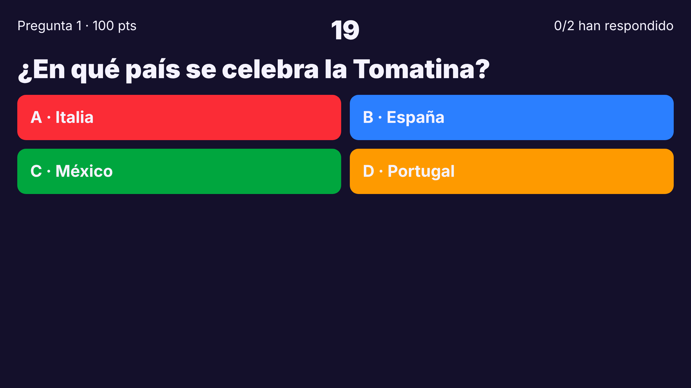
  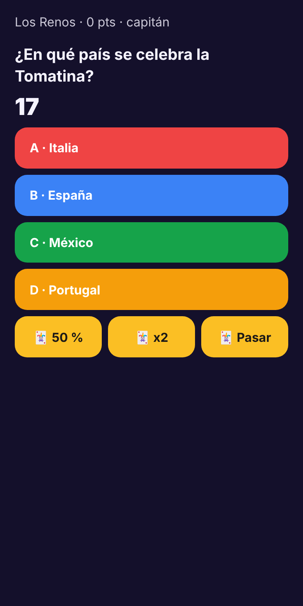
</p>

## Cómo se juega

1. El presentador crea la partida, añade **equipos** y **preguntas/retos** y abre la pantalla de la TV.
2. Cada jugador entra con el **código** (o el QR) desde su móvil y elige equipo. **El primero de cada equipo es el capitán**: es quien responde y usa comodines.
3. El presentador lanza rondas. En una **pregunta** responden los equipos; en un **reto** un equipo lo hace y el presentador decide si lo ha conseguido.
4. Al final de la partida, podio.

### Pregunta
- Opciones A–D (o verdadero/falso). Cuenta atrás de 20 s por defecto.
- Acierto = puntos de la pregunta. Con **comodín doble**, ×2. Con **rapidez** activada (opcional, apagada por defecto), un extra de hasta el 50 % según el tiempo que sobre.
- La ronda se cierra cuando **todos los equipos activos han respondido**, cuando se acaba el tiempo o cuando el presentador pulsa «Cerrar ya». Las tres vías pasan por la misma función SQL.
- La **respuesta correcta no sale del servidor** hasta que la ronda se cierra, ni siquiera en la API.

### Comodines (uno de cada por equipo y partida, solo uno por ronda)
| Comodín | Efecto |
|---|---|
| 🃏 50 % | Oculta dos respuestas incorrectas (solo en preguntas de cuatro opciones) |
| 🃏 ×2 | Duplica los puntos si aciertan |
| 🃏 Pasar | No puntúa y cuenta como respondida |

### Reto
Se asigna al equipo con menos puntos. El presentador pulsa «Lo han conseguido» (suma los puntos) o «No».

## Flujo de una partida

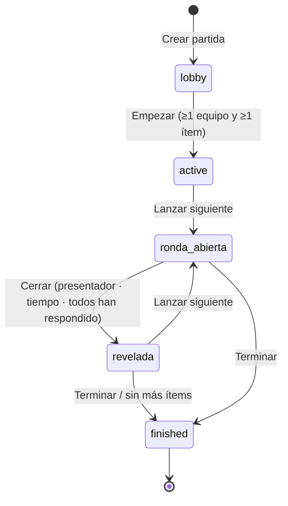

## Quién hace qué en cada fase

| Fase | TV | Móvil | Presentador |
|---|---|---|---|
| Sala | Código, QR y equipos | Nombre y elegir equipo | Equipos, preguntas y retos; «Empezar» |
| Pregunta | Enunciado, opciones y cuenta atrás | Opciones y comodines (capitán) | «Cerrar ya» |
| Reto | Texto y equipo que lo hace | Aviso al equipo | «Lo han conseguido» / «No» |
| Resultado | Respuesta correcta y qué equipo eligió cada una | «¡Correcto! +N» | «Lanzar siguiente» |
| Final | Podio | Resultados | — |

## Arquitectura

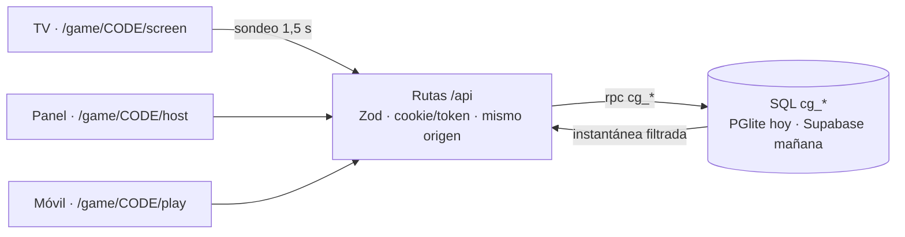

Toda la lógica de decisión (puntos, quién puede responder, cierre, secretos) está en funciones SQL `cg_*` con bloqueo por partida e idempotencia; TypeScript solo valida, autentica y presenta. Detalle en [`docs/ARQUITECTURA.md`](docs/ARQUITECTURA.md) y [`docs/REGLAS-DE-JUEGO.md`](docs/REGLAS-DE-JUEGO.md). Es parte de [`partykit-casero`](https://github.com/ElMaxter99/partykit-casero).

## Galería

| Inicio | Panel (sala) | TV (sala) |
|---|---|---|
| 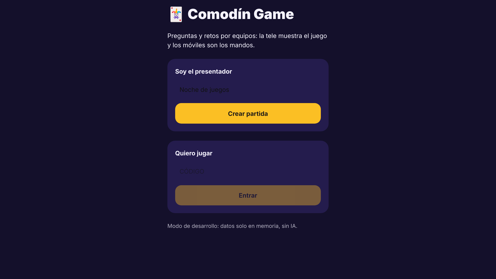 | 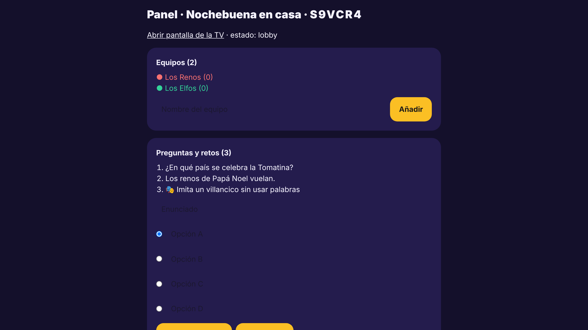 |  |

| Móvil: unirse | Móvil: equipo | Móvil: espera |
|---|---|---|
| 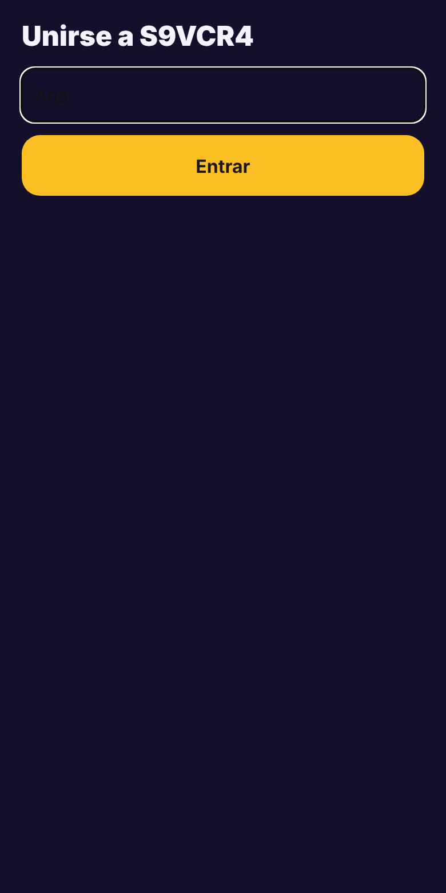 | 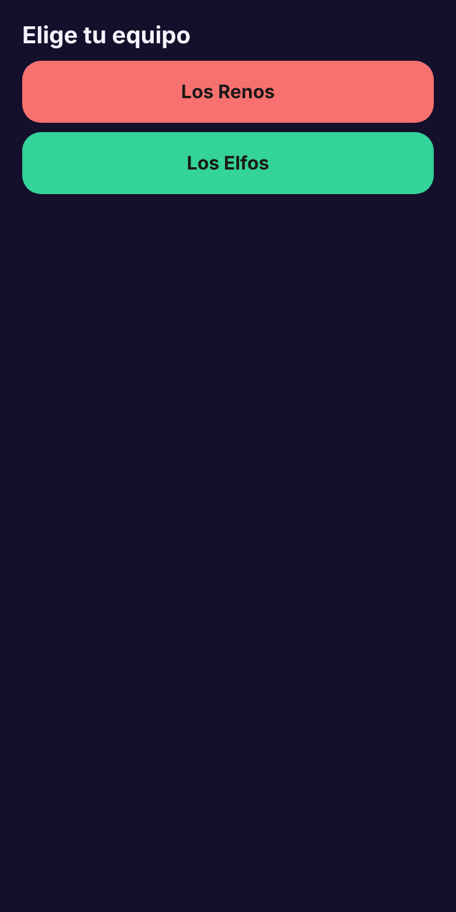 |  |

| Móvil: 50 % usado | Móvil: acierto | Móvil: final |
|---|---|---|
| 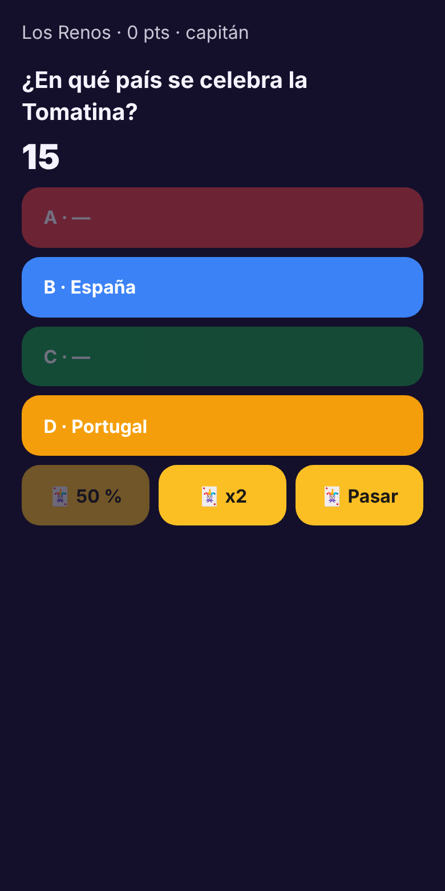 | 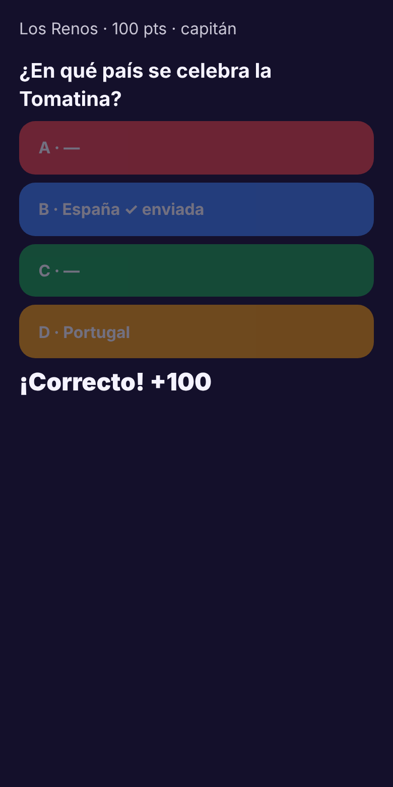 | 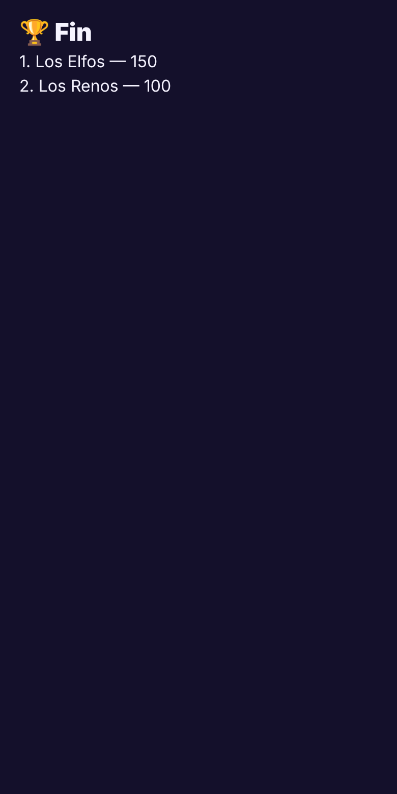 |

| TV: resultado | Panel: ronda | TV: reto |
|---|---|---|
| 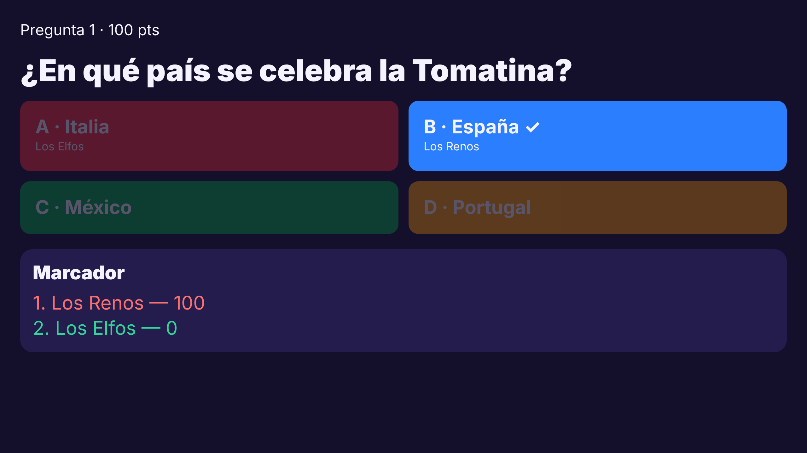 | 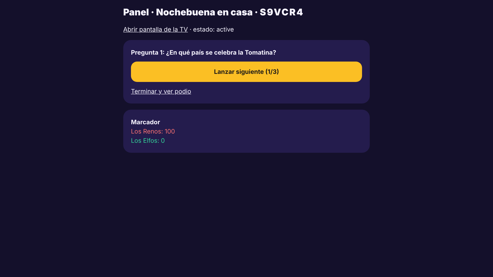 | 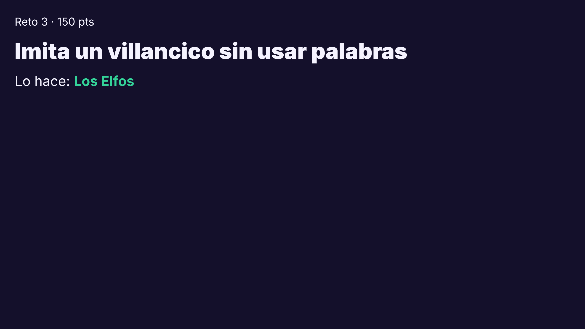 |

| Panel: reto | TV: podio |
|---|---|
| 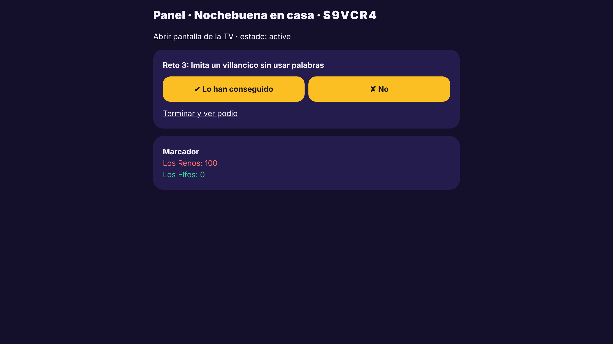 | 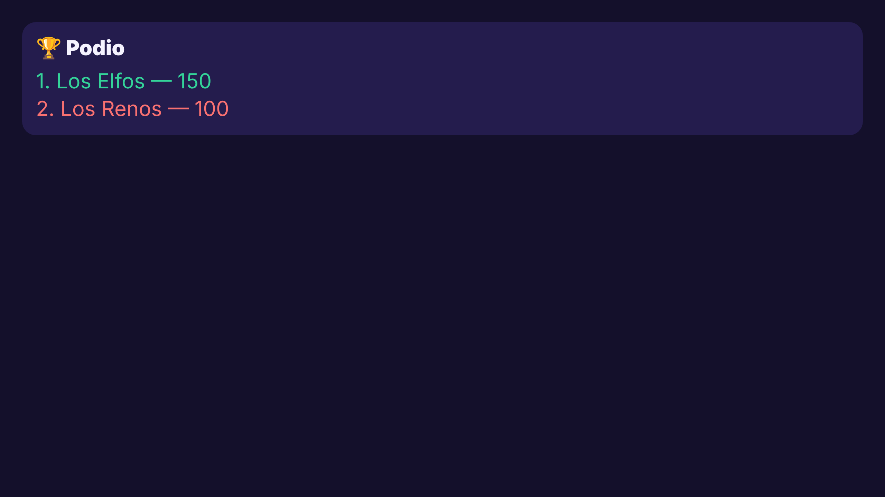 |

## Probarlo

```bash
npm install
npm test               # 8 tests de las reglas SQL (PGlite)
npm run typecheck
npm run dev            # http://localhost:3000 (datos en memoria)
npm run build && npm run docs:screenshots   # regenera docs/img/
```
Requiere Node ≥ 20. Para jugar con varios móviles, abre `http://IP-de-tu-ordenador:3000` en la red local.

## Qué no está verificado ni hecho todavía

- Solo se ha probado con PGlite: **no con Postgres real ni Supabase**, y falta el adaptador de Supabase.
- Sincronización por **sondeo cada 1,5 s**; sin Realtime. Sin sonido, sin tema de Navidad, sin podio descargable.
- El anfitrión es una **cookie de desarrollo**, no hay cuentas.
- Retos: solo los valida el presentador (votación y foto, en una versión futura). Sin modo sin móviles ni importación CSV todavía.
- Las capturas son de la app real con una partida de ejemplo; no hay pruebas e2e automáticas aún.
- Nada desplegado. Lista completa en [`docs/PENDIENTE.md`](docs/PENDIENTE.md); decisiones en [`docs/DECISIONES.md`](docs/DECISIONES.md).
