# Comodín Game · diseño («el figma»)

> **Regla del workspace:** ningún cambio llega al código sin estar antes aquí. Este documento, [`FLUJOS.md`](FLUJOS.md), los tokens y las maquetas de [`mockups/`](mockups/) son la fuente de verdad visual y de interacción. Si el código y este diseño difieren, manda el diseño (o se actualiza primero el diseño).

Estado de la implementación por pantalla: ver [§11](#11-estado-diseñado-vs-implementado). Cómo regenerar las imágenes: `PW_CHROMIUM_PATH=… node scripts/design-mockups.mjs`.

## 1. Idea de diseño: «Baraja»

Una noche de concurso con una **baraja de cartas** y un **comodín** de protagonista. La tele es la mesa, los móviles son la mano de cada equipo, el presentador reparte. Queremos **tensión, silencios, luces bajas y revelaciones que se dan la vuelta como una carta**, sin copiar a ningún programa concreto.

Cuatro ideas que mandan sobre todo lo demás:

1. **Todo es una carta.** La pregunta es una carta grande; cada respuesta es una carta con su letra y su palo en la esquina; los equipos se reparten «manos»; el podio son tres cartas.
2. **Tensión controlada.** Cada pregunta tiene un ritmo: reparto → pregunta → cartas boca abajo que se giran → confirmación → silencio → la correcta se da la vuelta.
3. **El móvil es tu mano, no una pantalla.** Cuatro cartas grandes, un gesto, confirmar.
4. **El presentador dirige el ritmo.** Guion, pausa dramática y control de cuándo se da la vuelta la carta.

### Lenguaje de formas (propio de Comodín)
| Elemento | Forma |
|---|---|
| Fondo | Rombos de arlequín tenues sobre ciruela, con foco magenta arriba |
| Pregunta | Carta crema grande, inclinada ~0,6°, con estrellas de comodín en dos esquinas |
| Respuestas | Cartas con **letra + palo** (♥ A, ♠ B, ♦ C, ♣ D) en dos esquinas; boca abajo con dorso rayado |
| Etiquetas | Fichas de papel ligeramente giradas (−2° / +2°) |
| Temporizador | Hilera de **10 fichas** que se apagan (rojas y brillantes en los últimos segundos) |
| Equipos | «Manos»: franja con color del equipo, nombre y puntos |
| Comodines | Cartas pequeñas con ★ |
| Acentos | **Magenta** (comodín), **lima** (acierto), coral (fallo), ámbar (confirmada) |

### Es original: lo que NO hacemos
Ni logos, ni nombres de programas, ni su música, ni su tipografía, ni sus lemas, ni sus «salvavidas» con nombre propio (ni 50:50, ni llamada, ni público). **Ni formas ni composición de ningún concurso de televisión conocido** (nada de barras hexagonales doradas sobre azul, ni escalera de premios con escalones seguros, ni presentador frente a concursante). Nuestras señas son la baraja, el comodín y el arlequín. Comodines propios: **Tachar dos**, **Doble**, **Pasar**. Si dudas, cambia.

## 2. Pantallas (resumen)

| # | Pantalla | Dónde | Maqueta |
|---|---|---|---|
| 1 | Sala de espera | TV | `tv-1-sala` |
| 2 | Presentación de ronda | TV | `tv-2-presentacion` |
| 3 | Pregunta abierta | TV | `tv-3-pregunta` |
| 4 | Respuesta confirmada (suspense) | TV | `tv-4-confirmada` |
| 5 | Revelación | TV | `tv-5-revelacion` |
| 6 | Marcador (cartas por equipo) | TV | `tv-6-marcador` |
| 7 | Reto | TV | `tv-7-reto` |
| 8 | Podio | TV | `tv-8-podio` |
| 9 | Pregunta (pulsador) | móvil | `movil-1-pregunta` |
| 10 | Confirmar respuesta | móvil | `movil-2-confirmar` |
| 11 | Esperando | móvil | `movil-3-esperando` |
| 12 | Resultado | móvil | `movil-4-resultado` |
| 13 | Usar comodín | móvil | `movil-5-comodin` |
| 14 | Panel del presentador | panel | `panel-1-presentador` |

### TV
| | |
|---|---|
| 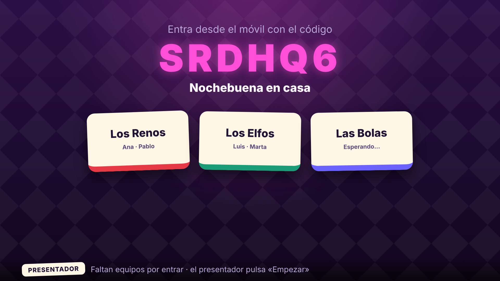 | 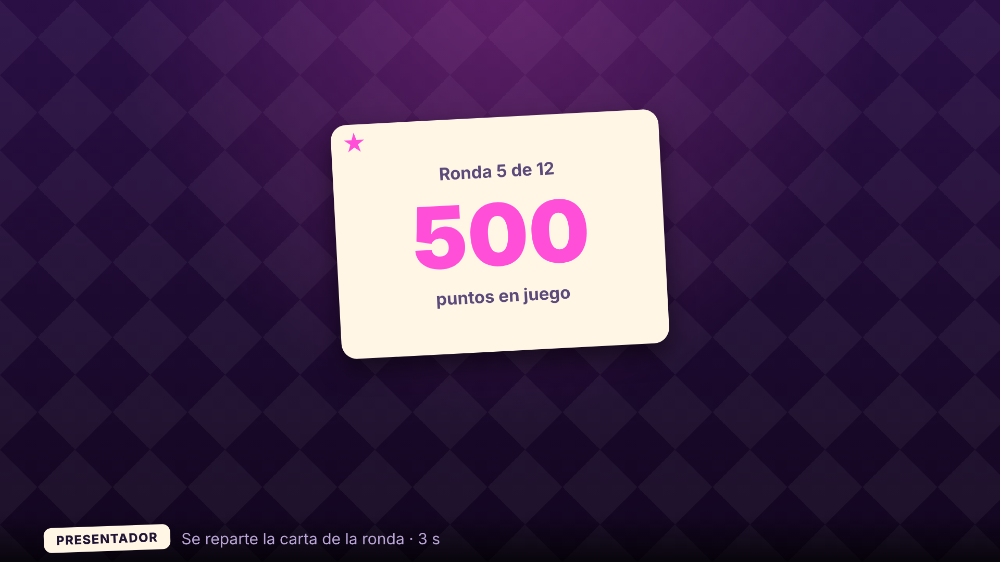 |
| 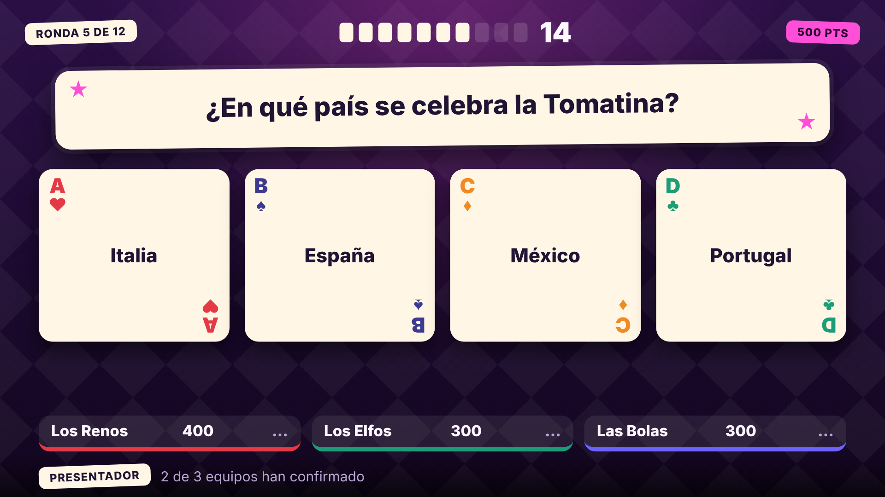 | 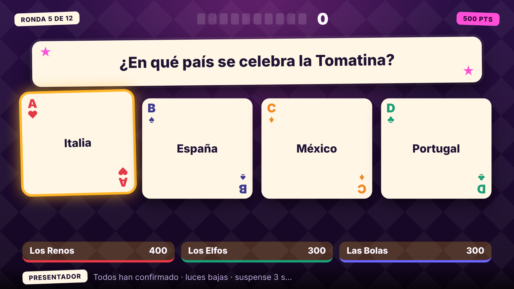 |
| 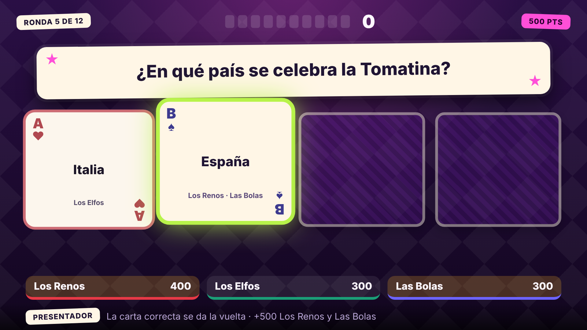 | 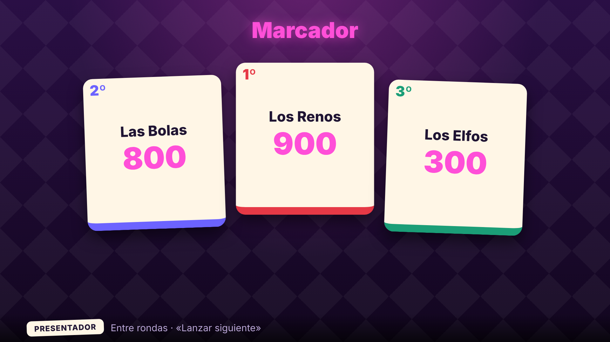 |
| 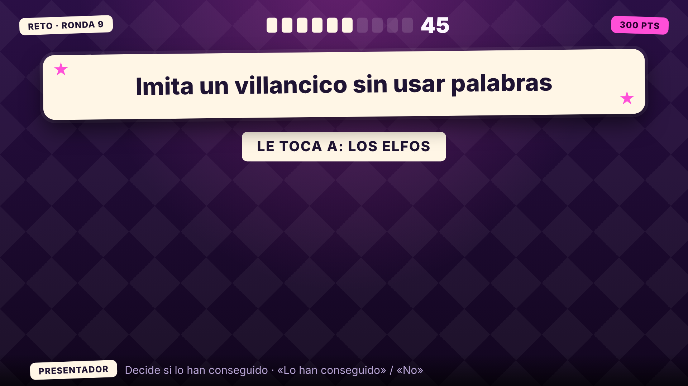 | 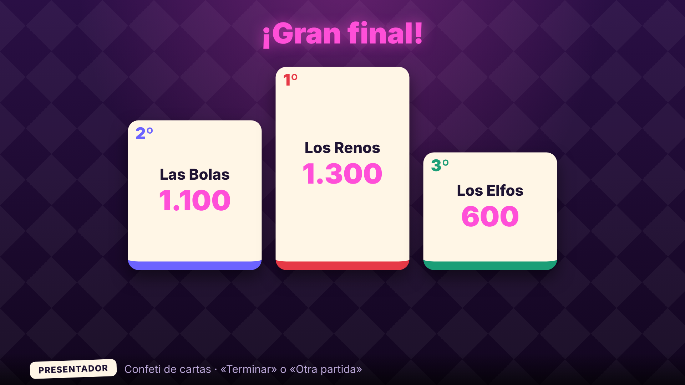 |

### Móvil y panel

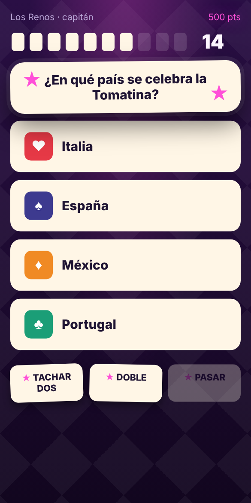 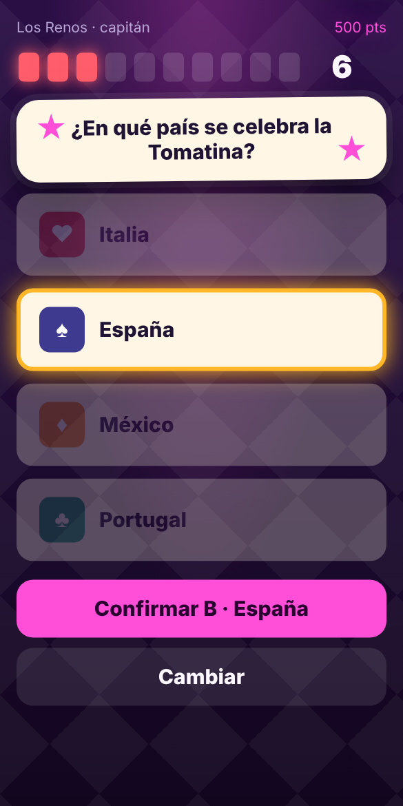 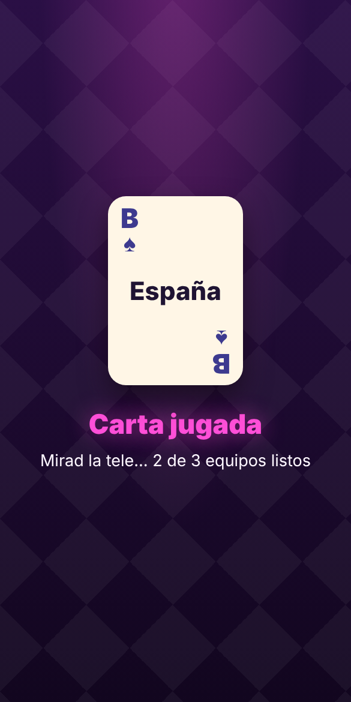 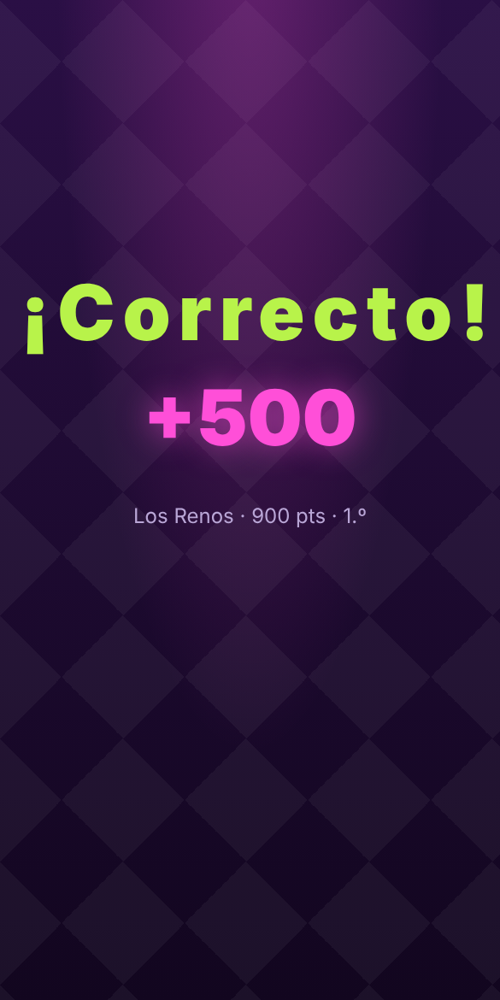 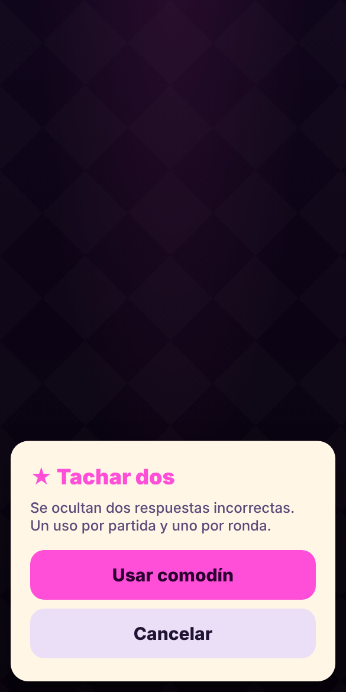

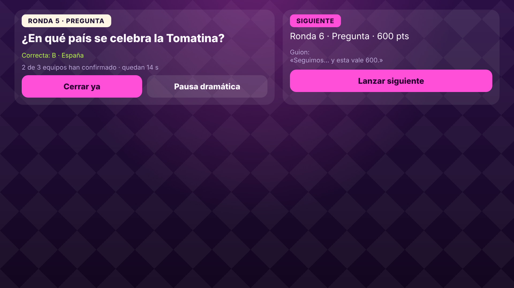

## 3. Tokens (`tokens.css`)

| Token | Valor | Uso |
|---|---|---|
| `--felt-0/1` | `#12061f` `#2a0f45` | Fondo (ciruela) |
| `--card` / `--card-ink` | `#fff6e6` / `#1f1433` | Cara de las cartas y su texto |
| `--joker` | `#ff4fd8` | Acento principal (comodín): puntos, botón principal |
| `--lime` / `--coral` | `#b8f34a` / `#ff5d6c` | Correcta / incorrecta |
| `--amber` | `#ffb627` | Respuesta confirmada, a la espera |
| `--suit-a/b/c/d` | rojo, índigo, naranja, verde | Color del palo de cada opción (siempre con letra y símbolo: no depende solo del color) |

Los **temas de estación** (Navidad, Halloween…) solo redefinen estos tokens y los textos/sonidos de §8; no tocan estructura ni reglas.

## 4. Tipografía y forma
- Titulares y números: `Trebuchet MS` / system, **peso 800–900**; etiquetas en mayúsculas con espaciado. Sin fuentes externas: cero dependencias y cero cookies.
- Formas: rectángulos de esquina muy redondeada (cartas), fichas giradas, hileras de pips; sin hexágonos.
- TV pensada para 1280×720 escalable a 4K; texto mínimo en TV 24 px.

## 5. Componentes
`tag` (ficha de etiqueta, `tag pts` para los puntos), `pips` (temporizador de 10 fichas), `qcard` (carta de pregunta), `card` (carta de respuesta; estados `back`, `idle`, `locked`, `correct`, `wrong`, `out`), `hand` (franja de equipo: «pensando…» / «confirmado»), `host-line` (barra del presentador), `pcard` (carta de respuesta en el móvil), `joker` (carta de comodín), `btn` / `btn ghost`.

Estados de una carta de respuesta en TV:

| Estado | Aspecto | Cuándo |
|---|---|---|
| back | Dorso rayado | Reparto: aparecen boca abajo y se giran de una en una |
| idle | Cara crema con letra y palo | Pregunta abierta |
| locked | Se levanta y se inclina, borde ámbar | Algún equipo ha confirmado; **no se dice cuál** hasta la revelación |
| correct | Se levanta y crece, borde lima con brillo | Revelación (la carta «se da la vuelta» y se ilumina) |
| wrong | Borde coral, colores apagados | La elegida que falla |
| out | Dorso, apagada | Descartada (revelación o «Tachar dos») |

## 6. Coreografía de una pregunta (tiempos)

| t | TV | Sonido | Móvil |
|---|---|---|---|
| 0 s | **Presentación**: se reparte la carta de la ronda: «Ronda N · P puntos» | Redoble corto | «Atentos» |
| 3 s | Aparece la carta de pregunta; después, las 4 respuestas llegan boca abajo y se giran de una en una (0,4 s cada una) | «tic» por respuesta | Se activan los pulsadores al aparecer la 4.ª |
| 3 s – fin | Cuenta atrás: las 10 fichas se van apagando; en ≤ 5 s las que quedan se ponen rojas | Pulso grave que acelera | Elegir (toque) → **Confirmar** |
| al confirmar | La tira de equipos marca «confirmado» (sin decir qué) | Campanilla suave | «Respuesta enviada» |
| cierre | Luces bajas, respuestas confirmadas en naranja | Silencio y pulso lento | Esperando |
| +3 s | **Suspense** (se puede alargar con «Pausa dramática» del presentador) | Pulso | — |
| +3 s | **Revelación**: la correcta se levanta y se ilumina; las demás se oscurecen; se ve qué equipo eligió qué | Acierto o fallo | «¡Correcto! +N» / «Esta vez no» |
| +6 s | Las manos de los equipos se reordenan con los nuevos puntos | Subida | Posición |

`prefers-reduced-motion`: sin parpadeos ni latido; se mantienen los cambios de color y los tiempos.

## 7. Presentador (panel)
Una acción principal grande según la fase (Lanzar siguiente / Cerrar ya / Revelar / Lo han conseguido). Además: **guion** (frase sugerida para decir en cada fase), **Pausa dramática** (retrasa la revelación hasta que el presentador pulse «Revelar»), pausa de partida y vista del resultado de cada equipo antes de revelar (solo en el panel). Mismo panel en móvil/tablet.

## 8. Sonido (sintetizado, WebAudio; sin ficheros)
Reparto de cartas, tic, pulso, campanilla, acierto (acorde mayor ascendente), fallo (descenso), subida de marcador, fanfarria de podio. Todo propio y sintetizado, con interruptor de silencio en el panel y volumen en la TV. Por tema se cambian la escala y las frases, no la estructura.

## 9. Textos (extracto)
«Atentos…» · «Respuesta enviada» · «Mirad la tele» · «¡Correcto! +500» · «Esta vez no» · «¡Gran final!». Idioma: español, tono cercano y teatral.

## 10. Accesibilidad
Cada opción lleva letra además de color; contraste ≥ 4.5:1 en textos; objetivos táctiles ≥ 56 px; sin parpadeo > 3 Hz; `prefers-reduced-motion`; la TV nunca depende del sonido (todo tiene señal visual).

## 11. Estado: diseñado vs implementado

| Elemento | Diseñado | Implementado |
|---|---|---|
| Tokens y componentes (Baraja) | ✔ | por hacer |
| TV: presentación → pregunta → suspense → revelación | ✔ | por hacer |
| TV: marcador con cartas por equipo | ✔ | por hacer |
| Móvil: elegir + confirmar, comodines con hoja de confirmación | ✔ | por hacer |
| Panel: guion y pausa dramática | ✔ | por hacer |
| Sonido sintetizado | ✔ | por hacer |
| Mecánicas extra de §12 | propuesta | **no** (requieren SQL y tu OK) |

## 12. Propuestas que cambian reglas (NO incluidas; solo si el propietario las pide)
Dan más drama pero cambian la puntuación. **No están en el diseño base ni se implementan sin elegirlas.** Si se eligen, se presentan con el lenguaje de la baraja (no como escalera):
1. **Apuesta:** antes de revelar, un equipo puede «apostar una carta» (arriesgar el doble o nada).
2. **Mano segura:** cada N rondas el equipo «guarda» su marcador (un fallo no baja de ahí), mostrado como una carta guardada junto a la mano.
3. **Puntos crecientes por ronda** (100, 200…), mostrados en la carta de reparto.

## 13. Cómo se cambia el diseño
1. Edita `design/` (tokens, maquetas, `DESIGN.md`, `FLUJOS.md`) y regenera las imágenes.
2. Revisa las imágenes con el propietario.
3. Solo entonces se toca el código, citando la pantalla del diseño. Un cambio de código sin cambio de diseño previo es un fallo de proceso.
