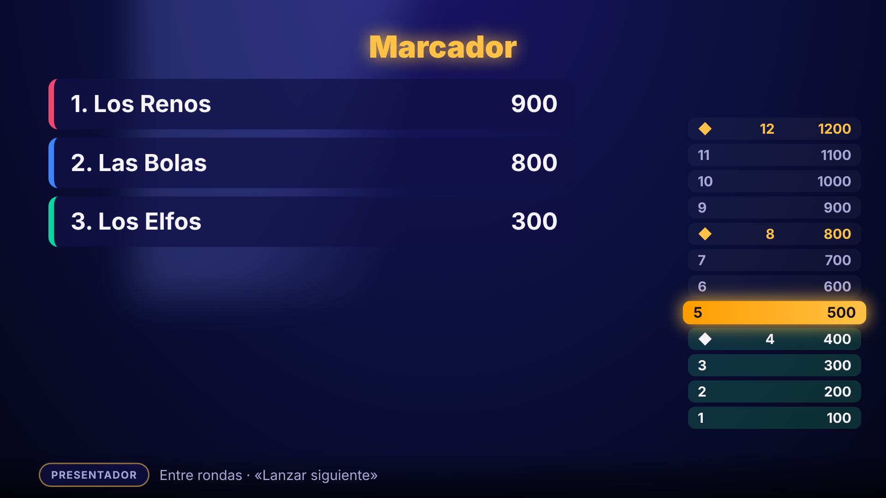

# Comodín Game · diseño («el figma»)

> **Regla del workspace:** ningún cambio llega al código sin estar antes aquí. Este documento, [`FLUJOS.md`](FLUJOS.md), los tokens y las maquetas de [`mockups/`](mockups/) son la fuente de verdad visual y de interacción. Si el código y este diseño difieren, manda el diseño (o se actualiza primero el diseño).

Estado de la implementación por pantalla: ver [§11](#11-estado-diseñado-vs-implementado). Cómo regenerar las imágenes: `PW_CHROMIUM_PATH=… node scripts/design-mockups.mjs`.

## 1. Idea de diseño: «Gala»

Una noche de concurso en un plató. La tele es un escenario, los móviles son los pulsadores, el presentador es el maestro de ceremonias. Queremos **tensión, silencios, luces bajas y revelaciones lentas**: lo que hace dramático a un gran concurso de televisión o a una noche de preguntas de streamer, sin copiar a ninguno.

Cuatro ideas que mandan sobre todo lo demás:

1. **Tensión controlada.** Cada pregunta tiene un ritmo: presentación → pregunta → confirmación → silencio → revelación. Nada se muestra de golpe.
2. **Un foco, una cosa.** La TV muestra una sola cosa importante cada vez; todo lo demás se atenúa.
3. **El móvil es un pulsador, no una pantalla.** Botones enormes, un solo gesto, nada que leer.
4. **El presentador dirige el ritmo.** Tiene guion, pausa dramática y el control de cuándo se revela.

### Es original: lo que NO hacemos
Ni logos, ni nombres de programas, ni su música, ni su tipografía, ni sus lemas, ni sus «salvavidas» con nombre propio (ni 50:50, ni llamada, ni público), ni su disposición exacta (respuestas en hexágono apilado a la izquierda de un presentador). Usamos: nuestra paleta, nuestros comodines (**Tachar dos**, **Doble**, **Pasar**), nuestro lenguaje («escalón», «gala»), sonidos sintetizados propios. Si dudas, cambia.

## 2. Pantallas (resumen)

| # | Pantalla | Dónde | Maqueta |
|---|---|---|---|
| 1 | Sala de espera | TV | `tv-1-sala` |
| 2 | Presentación de ronda | TV | `tv-2-presentacion` |
| 3 | Pregunta abierta | TV | `tv-3-pregunta` |
| 4 | Respuesta confirmada (suspense) | TV | `tv-4-confirmada` |
| 5 | Revelación | TV | `tv-5-revelacion` |
| 6 | Marcador y escalera | TV | `tv-6-escalera` |
| 7 | Reto | TV | `tv-7-reto` |
| 8 | Podio | TV | `tv-8-podio` |
| 9 | Pregunta (pulsador) | móvil | `movil-1-pregunta` |
| 10 | Confirmar respuesta | móvil | `movil-2-confirmar` |
| 11 | Esperando | móvil | `movil-3-esperando` |
| 12 | Resultado | móvil | `movil-4-resultado` |
| 13 | Usar comodín | móvil | `movil-5-comodin` |
| 14 | Panel del presentador | panel | `panel-1-presentador` |

### TV
| | |
|---|---|
|  |  |
|  |  |
|  |  |
|  |  |

### Móvil y panel

    

## 3. Tokens (`tokens.css`)

| Token | Valor | Uso |
|---|---|---|
| `--stage-0/1/2` | `#05061a` `#0d1040` `#1b1466` | Fondo del plató (degradado radial) |
| `--gold` / `--gold-2` | `#ffc247` / `#ff9d00` | Acento: puntos, escalón actual, botón principal, comodines |
| `--ok` / `--bad` | `#2fe08a` / `#ff4d6d` | Correcta / incorrecta |
| `--locked` | `#ffb020` | Respuesta confirmada, esperando |
| `--opt-a/b/c/d` | rosa, azul, verde, amarillo | Letra de cada opción (siempre con letra: no depende solo del color) |
| `--panel` / `--panel-line` | azul translúcido / dorado | Tarjetas y bordes |

Los **temas de estación** (Navidad, Halloween…) solo redefinen estos tokens y los textos/sonidos de §8; no tocan estructura ni reglas.

## 4. Tipografía y forma
- Titulares y números: `Trebuchet MS` / system, **peso 800–900**, mayúsculas con espaciado en etiquetas. (Sin fuentes externas: cero dependencias y cero cookies.)
- Formas: **hexágono alargado** para pregunta y respuestas (`clip-path`), píldoras para etiquetas, círculo para temporizador y letras.
- TV pensada para 1280×720 escalable a 4K; tamaño mínimo de texto en TV 24 px (a 3 m se lee).

## 5. Componentes
`badge` (etiqueta/píldora), `timer` (anillo con cuenta atrás; se pone rojo y late en ≤ 5 s), `question` (hexágono), `ans` (respuesta: estados `idle`, `locked`, `correct`, `wrong`, `out`), `teams-strip` (equipos con color y puntos; «pensando…» / «confirmado»), `ladder` (escalera de puntos: `done`, `now`, `safe ◆`), `host-line` (barra inferior con la acción del presentador), `pbtn` (pulsador móvil), `joker` (comodín), `btn` / `btn ghost`.

Estados de una respuesta en TV:

| Estado | Aspecto | Cuándo |
|---|---|---|
| idle | Azul oscuro, borde dorado | Pregunta abierta |
| locked | Naranja con brillo | Un equipo (o todos) han confirmado; **no se dice cuál** hasta la revelación |
| correct | Verde con brillo y parpadeo | Revelación |
| wrong | Rojo apagado (la elegida que falla) | Revelación |
| out | Casi invisible | Descartada por revelación o por «Tachar dos» |

## 6. Coreografía de una pregunta (tiempos)

| t | TV | Sonido | Móvil |
|---|---|---|---|
| 0 s | **Presentación**: foco sobre «Ronda N · P puntos» (+ escalón seguro ◆ si toca) | Redoble corto | «Atentos» |
| 3 s | Aparece la pregunta; después, las 4 respuestas de una en una (0,4 s cada una) | «tic» por respuesta | Se activan los pulsadores al aparecer la 4.ª |
| 3 s – fin | Cuenta atrás; en ≤ 5 s late en rojo | Pulso grave que acelera | Elegir (toque) → **Confirmar** |
| al confirmar | La tira de equipos marca «confirmado» (sin decir qué) | Campanilla suave | «Respuesta enviada» |
| cierre | Luces bajas, respuestas confirmadas en naranja | Silencio y pulso lento | Esperando |
| +3 s | **Suspense** (se puede alargar con «Pausa dramática» del presentador) | Pulso | — |
| +3 s | **Revelación**: parpadea la correcta 3×; las demás se apagan; se ve qué equipo eligió qué | Acierto o fallo | «¡Correcto! +N» / «Esta vez no» |
| +6 s | Marcador y escalera suben | Subida | Posición |

`prefers-reduced-motion`: sin parpadeos ni latido; se mantienen los cambios de color y los tiempos.

## 7. Presentador (panel)
Una acción principal grande según la fase (Lanzar siguiente / Cerrar ya / Revelar / Lo han conseguido). Además: **guion** (frase sugerida para decir en cada fase), **Pausa dramática** (retrasa la revelación hasta que el presentador pulse «Revelar»), pausa de partida y vista del resultado de cada equipo antes de revelar (solo en el panel). Mismo panel en móvil/tablet.

## 8. Sonido (sintetizado, WebAudio; sin ficheros)
Redoble, tic, pulso, campanilla, acierto (acorde mayor ascendente), fallo (descenso), subida de marcador, fanfarria de podio. Todo propio y sintetizado, con interruptor de silencio en el panel y volumen en la TV. Por tema se cambian la escala y las frases, no la estructura.

## 9. Textos (extracto)
«Atentos…» · «Respuesta enviada» · «Mirad la tele» · «¡Correcto! +500» · «Esta vez no» · «Escalón seguro» · «¡Gran final!». Idioma: español, tono cercano y teatral.

## 10. Accesibilidad
Cada opción lleva letra además de color; contraste ≥ 4.5:1 en textos; objetivos táctiles ≥ 56 px; sin parpadeo > 3 Hz; `prefers-reduced-motion`; la TV nunca depende del sonido (todo tiene señal visual).

## 11. Estado: diseñado vs implementado

| Elemento | Diseñado | Implementado |
|---|---|---|
| Tokens y componentes (Gala) | ✔ | por hacer |
| TV: presentación → pregunta → suspense → revelación | ✔ | por hacer |
| TV: escalera de puntos (visual) | ✔ | por hacer |
| Móvil: elegir + confirmar, comodines con hoja de confirmación | ✔ | por hacer |
| Panel: guion y pausa dramática | ✔ | por hacer |
| Sonido sintetizado | ✔ | por hacer |
| Escalones seguros con efecto en reglas (propuesta, §12) | propuesta | **no** (requiere SQL y tu OK) |

## 12. Propuestas que cambian reglas (pendientes de tu decisión)
Estas ideas dan más drama pero cambian la puntuación, así que **no se implementan sin confirmarlas**:
1. **Escalones seguros:** cada N rondas el equipo «guarda» su marcador; un fallo no puede bajar de ahí.
2. **Plantarse:** antes de revelar, un equipo puede retirarse con lo que tiene.
3. **Puntos crecientes por ronda** (100, 200… configurable) en vez de puntos fijos por pregunta.

## 13. Cómo se cambia el diseño
1. Edita `design/` (tokens, maquetas, `DESIGN.md`, `FLUJOS.md`) y regenera las imágenes.
2. Revisa las imágenes con el propietario.
3. Solo entonces se toca el código, citando la pantalla del diseño. Un cambio de código sin cambio de diseño previo es un fallo de proceso.
