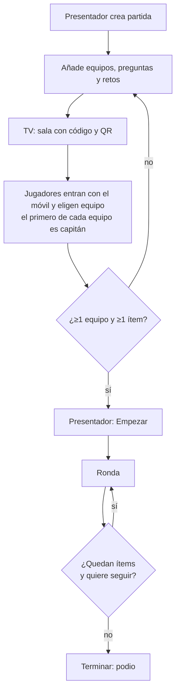
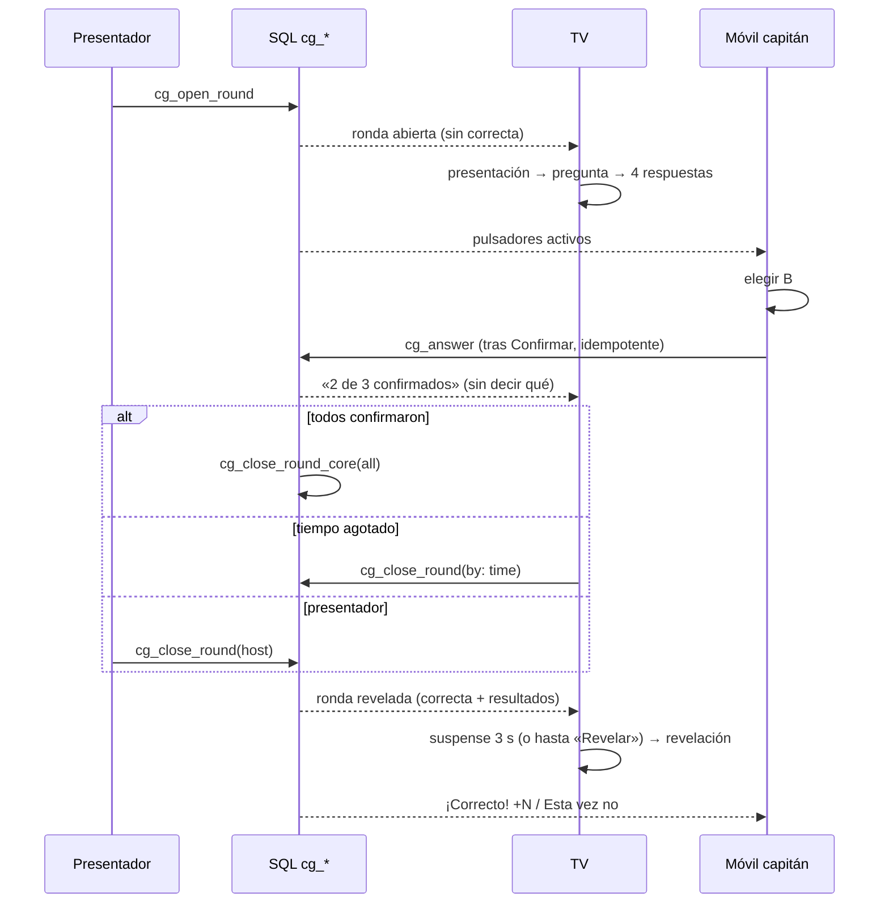
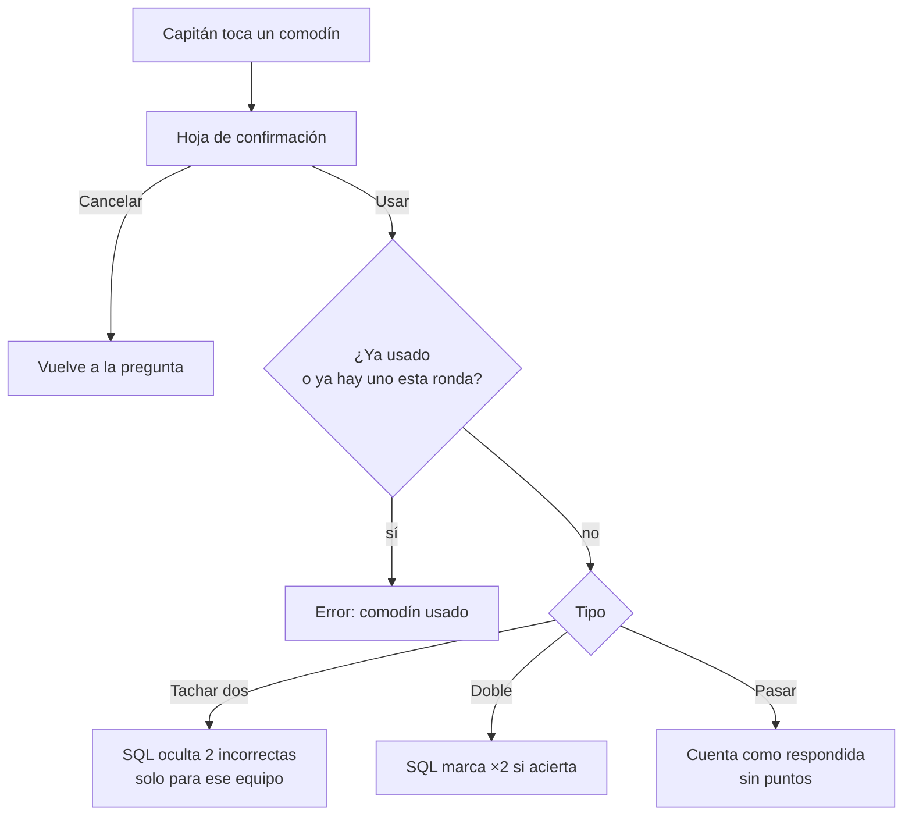
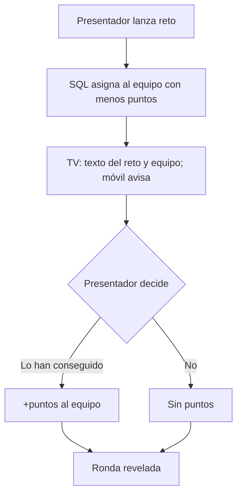
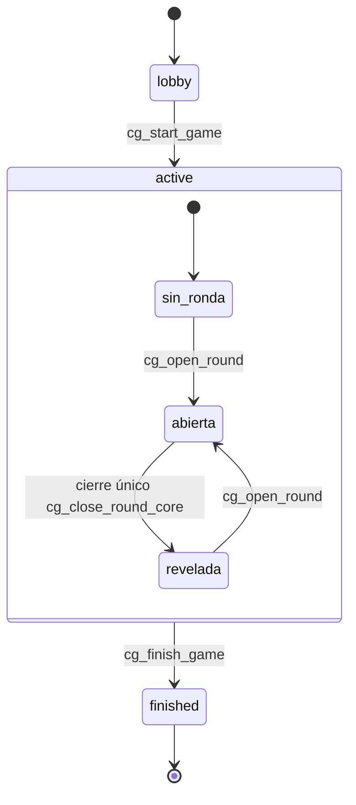

# Comodín Game · flujos completos

Complementa a [`DESIGN.md`](DESIGN.md). Cada flujo indica qué ve cada rol y qué función SQL decide.

## 1. Partida de principio a fin

## 2. Una ronda de pregunta (secuencia)

## 3. Comodines

## 4. Reto

## 5. Estados de la partida y de la ronda

## 6. Casos límite
| Caso | Qué pasa |
|---|---|
| Un jugador no capitán intenta responder | Error «Responde el capitán» (si el capitán está conectado) |
| El capitán se desconecta | Cualquier miembro puede responder; la primera respuesta gana (única por equipo) |
| Respuesta doble / reintento de red | Única por equipo y ronda; la clave de idempotencia devuelve lo mismo |
| Responde tras agotarse el tiempo | Rechazado por el servidor (`round_closed`); el reloj del móvil no cuenta |
| TV cerrada a mitad | Al reabrirla recupera el estado con la instantánea; el temporizador se recalcula con `server_time` |
| Se pierde la conexión del móvil | Reintento con la misma clave; la UI muestra «Reconectando…» |
| Empate en el podio | Comparten puesto |
